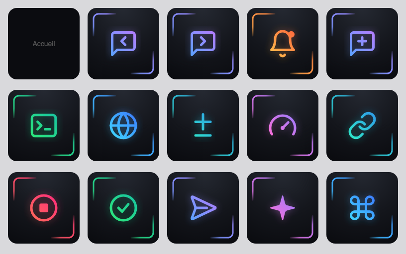
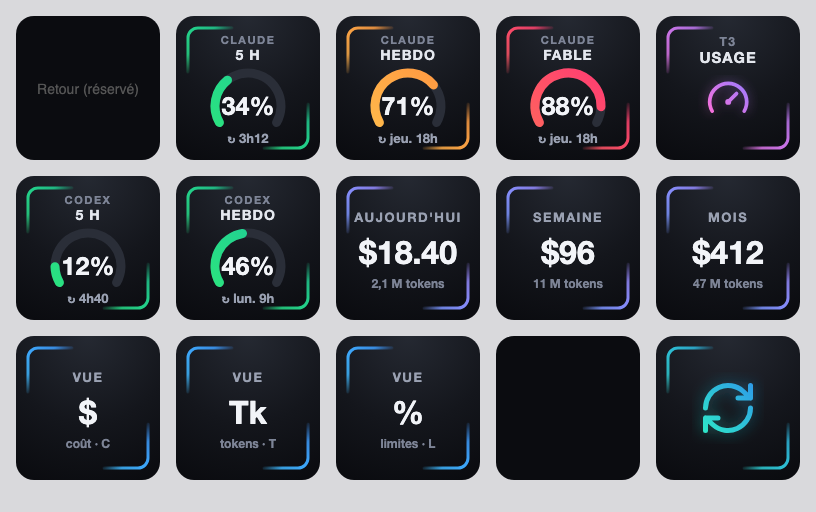

# T3 Code Controls for Stream Deck

Unofficial community plugin that controls [T3 Code](https://t3.codes) from an Elgato Stream Deck: thread navigation, attention and approval keys, and live provider usage gauges. It is not affiliated with or endorsed by the T3 Code maintainers.



## Actions

| Action | What it does |
|---|---|
| Raccourci T3 (`shortcut`) | Activates T3 Code and presses one of 17 keyboard shortcuts (threads, terminal, preview, diff, model picker, palette, editor, sidebar, settle, pin, usage views...) |
| Premier en attente (`first-waiting`) | Bell with the number of threads waiting for approval or input; press opens the oldest one |
| Approuver (`approve`) | Shows the oldest pending approval kind; short press opens the thread, long press (600 ms) approves it |
| Stop (`stop`) | Stops the running thread when exactly one is running (shows the count when several) |
| Jauge d'usage (`usage-gauge`) | One usage window (provider + window id or label) as a gauge |
| Usages, aperçu (`usage-overview`) | Session gauge plus weekly bar; press opens the usage page |
| Coût (`usage-cost`) | Cost tile for today, week or month |
| Actualiser (`refresh`) | Forces a re-probe of the usage limits |

## Install from source

```sh
npm i
npm run build
npx streamdeck link dev.leokun.t3code.sdPlugin
```

Requires Stream Deck 7.1+ and macOS 12+. Use `npm run icons` to regenerate the images (needs Google Chrome) and `npm test` for the unit tests.

## Connect to T3 Code

Every action has a Connection section in its inspector (settings are global).

1. Mint a token:

   ```sh
   t3 auth session issue --token-only \
     --scope orchestration:read --scope orchestration:operate --scope diagnostics:read
   ```

2. Paste it in the Token field. The default TTL is 30 days, so you will need to mint a new one after that. The Stream Deck app stores the token in plain text.
3. Leave Server URL empty: the local server is auto-discovered from `~/.t3/userdata/server-runtime.json` (then `~/.t3/dev/`, honoring `$T3CODE_HOME`). Set it only to override, for example `http://127.0.0.1:3773`.
4. App bundle ID defaults to `com.t3tools.t3code`.

### macOS permission

Shortcut keys are injected with AppleScript. Grant Accessibility access in System Settings > Privacy & Security > Accessibility > Stream Deck.

## Suggested layout

A 3x5 main page with navigation, terminal, preview, diff, attention, approve, stop and the usage overview key, plus a Usages folder holding gauges for Claude 5h, weekly and Fable, cost tiles (day, week, month), view switches and refresh.



## Known limits

- macOS only for now (keystroke injection uses AppleScript).
- The Usages folder is a native Stream Deck folder; the entry key cannot be live inside a native folder.
- Dynamic keys are rendered as SVG; check them on a real device.

## License

MIT
